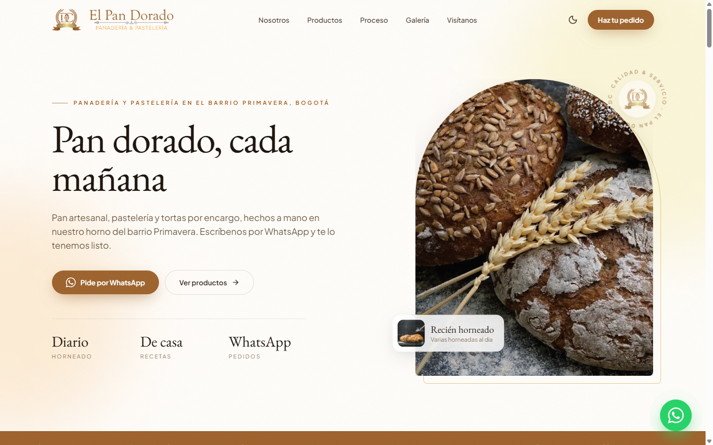
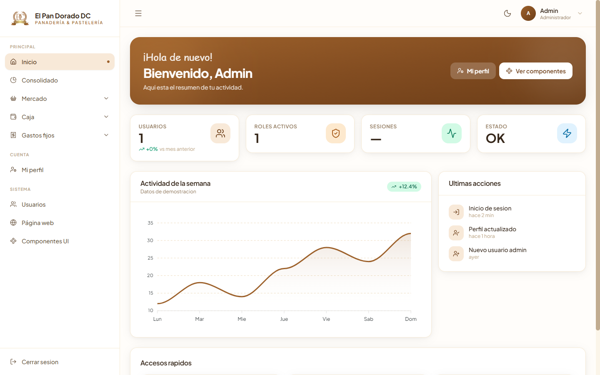
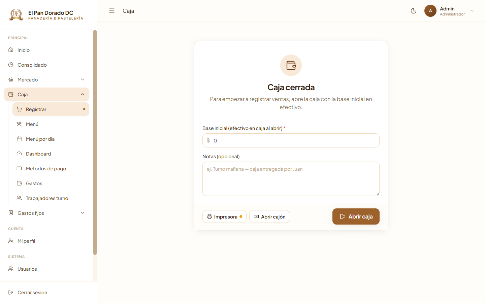
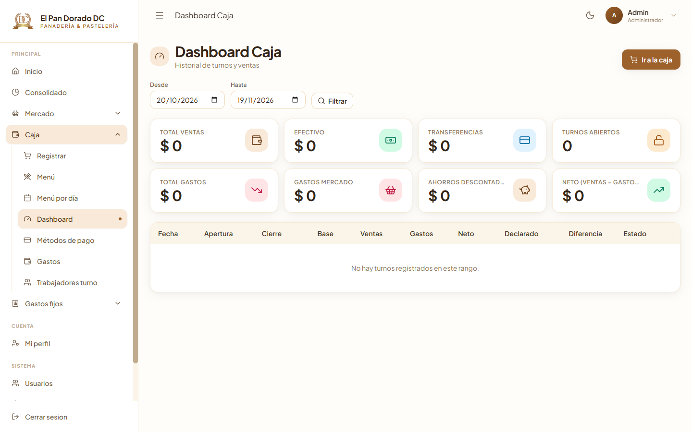

# El Pan Dorado DC — POS de panadería con equipo de caja dedicado

Sistema de caja, inventario y finanzas para una panadería en Bogotá, con su página web editable desde el panel y un equipo POS en modo kiosco con impresora de recibos.



## Contexto

Variante del sistema de restaurantes (ver Dorilokos / Sopas y Sopitas) adaptada a una panadería que atiende en mostrador con un equipo táctil dedicado, impresora térmica de 58 mm y cajón monedero.

## Funcionalidades

- **Caja (POS)** con turnos, base, ventas por categorías y métodos de pago.
- **Equipo POS en modo kiosco:** instalador para Windows, pantalla completa, teclado en pantalla solo cuando no hay teclado físico.
- **Impresión de recibos** en impresora térmica de 58 mm al cobrar y botón para **abrir el cajón monedero**.
- **Módulo “Página web”:** el negocio edita textos, fotos, productos, horarios, proceso y galería de su landing pública desde el panel.
- **Mercado e inventario** vinculado a la caja, **gastos fijos** y **consolidado** de ingresos y egresos.
- Eliminación lógica (*soft delete*) de categorías y productos para no romper el histórico.
- Roles: administrador y ventas (solo caja).

## Stack

- **Backend:** PHP 8, Laravel 9, MySQL/MariaDB
- **Autenticación y permisos:** Laravel Breeze + spatie/laravel-permission (roles y permisos)
- **Frontend:** Blade, Alpine.js, Tailwind CSS, Preline UI, ApexCharts, GSAP, Lenis, Tom Select

## Capturas

**Dashboard**



**Caja con impresora y cajón monedero**



**Dashboard de caja**



## Arquitectura

Este sistema forma parte de una familia de aplicaciones para restaurantes que comparten el mismo núcleo (caja, menú, mercado, inventario, nómina y finanzas) y se despliegan por separado para cada negocio, cada uno con su identidad visual y ajustes propios. La lógica de negocio vive en servicios (`app/Services`), los controladores se mantienen delgados y los assets se compilan con Vite para desplegar en hosting compartido sin Node en el servidor.

## Instalación local

Requisitos: PHP 8.0+ (con extensiones `gd`, `zip`, `intl`), Composer, Node 18+ y MySQL/MariaDB.

```bash
git clone <url-del-repositorio>
cd pandoradodc
composer install
npm install && npm run build
cp .env.example .env        # configura la conexión a la base de datos
php artisan key:generate
php artisan migrate --seed
php artisan serve
```

La aplicación queda disponible en `http://localhost:8000`. Los seeders crean los roles y datos iniciales (revisa `database/seeders`).

## Notas

- Proyecto desarrollado para un cliente real y desplegado en producción. Las capturas se tomaron en un entorno local; el historial de este repositorio se depuró para no incluir credenciales ni copias de bases de datos.

## Autor

**Santiago Bellaizán** — Desarrollador Full Stack (Laravel · PHP · MySQL · JavaScript)

- GitHub: [@Santibc](https://github.com/Santibc)
